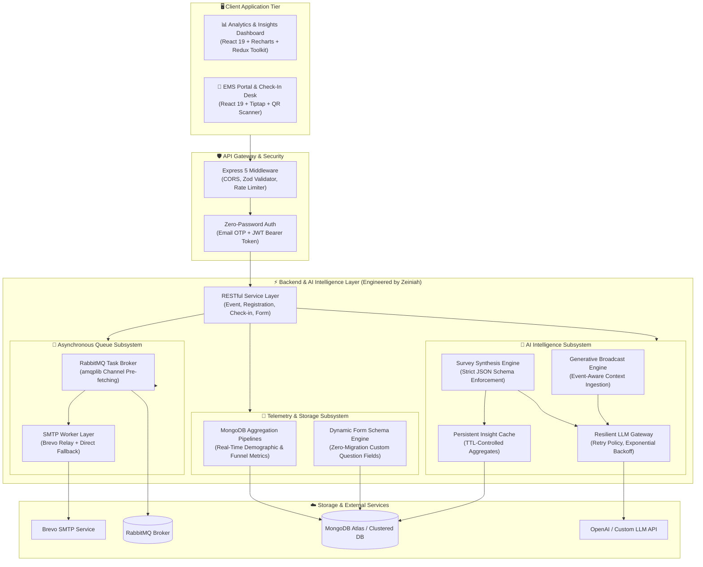

# Event-Intelligence-Platform

<div align="center">


<p align="center">
  <strong>Enterprise Event Telemetry, Dynamic MongoDB Schema Handling & LLM-Driven Synthesis Engine</strong><br />
  <em>A full-stack production architecture orchestrating automated registration workflows, real-time check-in telemetry, asynchronous queuing, and generative AI sentiment intelligence.</em>
</p>

</div>

---

## 🏛️ System Architecture

The **Event-Intelligence-Platform** is organized as a decoupled, multi-tier system engineered for resilience, data hygiene, and high-throughput event operations.



---

## 🚀 Core Engineering Deep-Dive (Backend & AI)

### 1. LLM-Driven Survey Synthesis & Sentiment Engine
*File: `backend/src/services/survey-analytic-insight.service.ts`*
- **Problem**: Raw post-event survey data contains hundreds of unstructured, variable-length text responses that event organizers and exhibitors cannot process in real time.
- **Implementation**:
  - Implements an automated synthesis pipeline that ingests qualitative attendee feedback, applies domain-specific system prompts, and extracts:
    - **Executive Summary** (max 2 sentences identifying dominant audience sentiment).
    - **Key Findings** (top 3 critical friction points or attendee desires).
    - **Exhibitor Action Points** (high-utility operational recommendations).
    - **Opportunity & Risk Watchouts** (early indicator anomalies).
  - **Deterministic Output Bounding**: Enforces strict JSON-only contracts without raw markdown wrapping, guarded by defensive deserialization (`safeParse`).
  - **Token Optimization & Caching**: Employs `event-ai-insight-cache.schema.ts` to cache computed synthesis objects against event hash signatures, eliminating redundant inference costs.

### 2. High-Performance MongoDB Aggregation Pipelines
*File: `backend/src/services/survey-analytic.service.ts` & `event-analytic.service.ts`*
- **Multi-Stage Telemetry**: Ingests high-concurrency ticket check-in and survey submissions, compiling real-time conversion rates, attendance velocity, and industry demographic distributions using native MongoDB aggregation pipelines (`$match`, `$group`, `$facet`, `$project`).
- **Dynamic Schema Flexibility**: Decouples event-specific registration fields through snapshot models (`form-snapshot-field.schema.ts`), allowing organizers to modify fields on the fly without breaking backward compatibility or running database migrations.

### 3. Asynchronous Queue Architecture & Graceful Degradation
*File: `backend/src/services/email-queue.service.ts`*
- Event broadcasts and ticket QR deliveries are dispatched asynchronously through **RabbitMQ** with channel prefetch management to prevent server memory bloat.
- **Fail-Safe Mechanism**: If RabbitMQ broker connectivity drops, the subsystem automatically falls back to synchronous direct SMTP dispatch via Brevo relay with transactional logging.

### 4. Zero-Password Security & Role-Based Access Control
*File: `backend/src/middlewares/auth.middleware.ts` & `models/constants/rolePermissions.ts`*
- Eliminates password compromise vectors using time-expiring (5-minute TTL) cryptographic Email OTP authentication with configurable attempt rate limits.
- Granular permission matrices (`requirePermission('MANAGE_EVENTS')`, `requireRole('super_admin')`) enforcing enterprise-grade zero-trust principles.

---

## 📦 Monorepo Directory Layout

```text
Event-Intelligence-Platform/
├── backend/                  # Core REST API, MongoDB Telemetry & AI Services
│   ├── src/
│   │   ├── config/           # Database, SMTP, and typed environment configs
│   │   ├── controllers/      # HTTP route delegates & status handlers
│   │   ├── middlewares/      # Zod validation, auth, error handling, rate limiting
│   │   ├── models/           # Mongoose schemas (Audit, Event, Participant, AI Cache)
│   │   ├── routes/           # REST endpoint routers (/analytics, /communications, etc.)
│   │   ├── services/         # Domain business logic & AI LLM pipelines
│   │   ├── utils/            # LLM client with exponential retry, JWT, API response
│   │   └── validators/       # Strict Zod validation schemas
│   ├── package.json
│   └── tsconfig.json
│
├── frontend-analytics/       # React 19 Analytics & AI Insights Dashboard
│   ├── src/                  # Recharts telemetry graphs, Redux store, Tailwind UI
│   ├── package.json
│   └── vite.config.ts
│
├── frontend-portal/          # React 19 EMS Management & Check-in Portal
│   ├── src/                  # QR scanner (html5-qrcode), Tiptap email editor
│   ├── package.json
│   └── vite.config.ts
│
├── docker-compose.yml        # Multi-container orchestration (App + Mongo + RabbitMQ)
├── .gitignore                # Production security & hygiene filter
└── README.md                 # System documentation & architectural reference
```

---

## 📡 Core API Reference

All backend routes are prefixed with `/api/v1`.

| Module | Method | Endpoint | Description |
| :--- | :--- | :--- | :--- |
| **AI Analytics** | `GET` | `/analytics/events/:eventId/insights` | Generates / retrieves AI-synthesized event intelligence |
| **AI Analytics** | `GET` | `/analytics/events/:eventId/survey/overview` | Aggregated survey metrics combined with LLM insights |
| **AI Analytics** | `GET` | `/analytics/events/:eventId/survey/insights` | Qualitative attendee feedback synthesis via LLM |
| **AI Comms** | `POST` | `/communications/generate` | Generates broadcast email subject & copy using LLM context |
| **Check-In** | `POST` | `/events/:eventId/check-ins/scan` | High-speed QR scanner endpoint for badge printing |
| **Form Engine** | `PUT` | `/form-builder/events/:eventId` | Dynamic registration form schema definition |
| **Auth** | `POST` | `/auth/request-otp` | Issues 6-digit cryptographic OTP to registered email |
| **Auth** | `POST` | `/auth/verify-otp` | Validates OTP and returns signed 8-hour JWT session |

---

## 🛠️ Getting Started & Setup

### Prerequisites
- **Node.js**: v20.x or higher
- **MongoDB**: v6.0 or MongoDB Atlas instance
- **RabbitMQ**: v3.x (optional; system falls back to direct SMTP if offline)
- **Docker & Docker Compose** (recommended for full-stack launch)

### Quickstart with Docker Compose

Run the entire platform (MongoDB, RabbitMQ, Backend, Frontend Analytics, and Portal) with a single command:

```bash
# Clone the repository
git clone https://github.com/zeyniaa/Event-Intelligence-Platform.git
cd Event-Intelligence-Platform

# Start all containers in detached mode
docker-compose up --build -d
```

Access points:
- **Backend API**: `http://localhost:5000`
- **Analytics Dashboard**: `http://localhost:5173`
- **Management Portal**: `http://localhost:5174`
- **RabbitMQ Management**: `http://localhost:15672` (guest / guest)

---

## 👩‍💻 Authorship & Engineering Credits

- **Zeiniah ([@zeyniaa](https://github.com/zeyniaa))**:
  - **Role**: Lead Backend & AI Systems Engineer
  - **Responsibilities**: Engineered the backend REST architecture, MongoDB telemetry aggregation pipelines, dynamic form schemas, resilient LLM synthesis gateway, and RabbitMQ asynchronous messaging queue.
- **Collaborative Project**:
  - Developed in collaboration with **Kelompok Rouf** for the **KADA x Yorindo EMS (Event Management System)** initiative.

---

<div align="center">
  <p><em>Engineered with precision, resilient data hygiene, and meaningful AI utility.</em></p>
</div>
